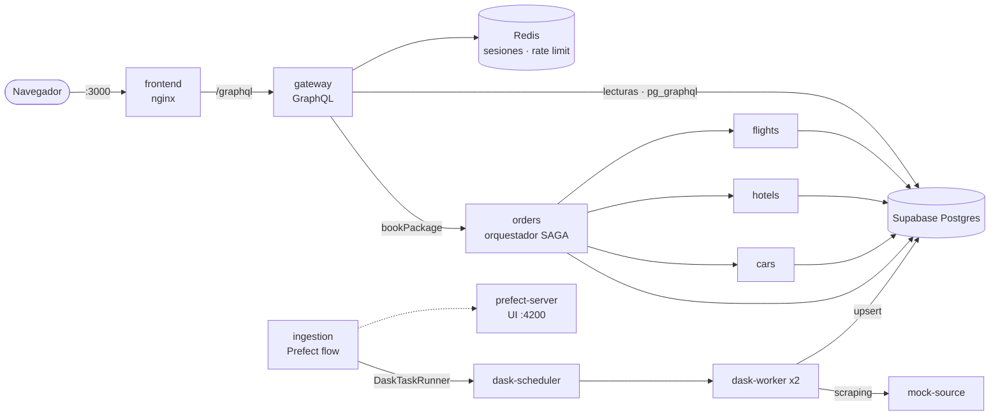

# WanderSync Travel Solutions

**Plataforma de empaquetamiento turístico dinámico** (vuelo + hotel + auto) construida con microservicios,
API Gateway **GraphQL**, patrón **SAGA**, ingesta distribuida con **Dask**, orquestación y observabilidad con
**Prefect**, y seguridad por diseño. Todo el ecosistema se despliega con **un solo comando**.

> Parcial práctico del segundo corte — *Patrones Arquitectónicos Avanzados*.
> **Autor:** Josue Sarmiento

| Documento | Contenido |
|---|---|
| [docs/Documento_Tecnico_WanderSync.pdf](docs/Documento_Tecnico_WanderSync.pdf) | **Documento técnico en PDF** (entregable) |
| [docs/ARQUITECTURA.md](docs/ARQUITECTURA.md) | Documento técnico en Markdown: diagramas de arquitectura, diagramas de secuencia SAGA y justificación de decisiones |
| [docs/GUION_DEMO.md](docs/GUION_DEMO.md) | Guion paso a paso para la demostración en vivo (puntos a, b, c y d del enunciado) |
| [docs/security/REPORTE_AUDITORIA_DEPENDENCIAS.md](docs/security/REPORTE_AUDITORIA_DEPENDENCIAS.md) | Evidencia formal de la auditoría de dependencias (`pip-audit`) |
| [docs/schema.graphql](docs/schema.graphql) | Esquema GraphQL completo del API Gateway |

---

## Arquitectura en una imagen



## Stack tecnológico

| Capa | Tecnología |
|---|---|
| Microservicios | Python 3.12 · FastAPI · psycopg 3 |
| API Gateway | GraphQL con Strawberry + `pg_graphql` (GraphQL nativo de Supabase) |
| Base de datos | Supabase Postgres 15 (`supabase/postgres`) — un *schema* por microservicio |
| Transacciones distribuidas | Patrón SAGA por **orquestación** (servicio `orders`) |
| Computación distribuida | Dask (scheduler + 2 workers) · Dask Bag |
| Orquestación y observabilidad | Prefect 3 (server + UI, deployment programado, reintentos) |
| Sesiones y rate limiting | Redis 7 |
| Frontend | HTML + CSS + JavaScript, servido por nginx (sin root) |
| Seguridad | Argon2id · sesiones regeneradas · rate limiting · `pip-audit` |
| Despliegue | Docker + Docker Compose |

## Requisitos

- **Docker Desktop** abierto (con "Engine running"). Se recomiendan 8 GB de RAM asignados a Docker.
- Puertos libres en el host: `3000`, `4200`, `8080` y `8788`.

## Puesta en marcha

```bash
git clone <url-del-repositorio>
cd WanderSync
docker compose up -d --build
```

**No requiere ningún paso manual previo.** Las contraseñas tienen valores por defecto solo para desarrollo y
evaluación local. Para usar contraseñas propias, copia `.env.example` a `.env` y cámbialas antes de levantar
(si la base ya existía, recréala con `docker compose down -v`).

La primera vez tarda varios minutos porque descarga las imágenes. Al arrancar, el servicio `ingestion` ejecuta
automáticamente una **ingesta inicial** con Dask, así que el catálogo se llena en menos de un minuto. Después se
repite cada 10 minutos.

```bash
docker compose ps            # 14 contenedores en estado Up
```

### URLs

| URL | Qué es |
|---|---|
| http://localhost:3000 | **Frontend** de WanderSync (crear cuenta, buscar, reservar) |
| http://localhost:3000/graphql | **GraphiQL**: consola del API Gateway |
| http://localhost:4200 | **Prefect UI**: flujos, tareas, reintentos y logs |
| http://localhost:8788/status | **Dask dashboard**: tareas distribuidas en los workers |
| http://localhost:8080 | **Fuente mock**: el portal de viajes que se scrapea |

> Por diseño, los microservicios internos (`flights`, `hotels`, `cars`, `orders`), el `gateway`, la base de datos y
> Redis **no publican puertos**. Solo se llega a ellos a través del frontend o el gateway.

### Usuario de prueba

No hay usuarios precargados (no se versionan credenciales). En el frontend usa **Iniciar sesión → Regístrate**:
la contraseña debe tener mínimo 10 caracteres, con letras y números.

## Estructura del repositorio

```
WanderSync/
├── docker-compose.yml          # todo el ecosistema (14 contenedores)
├── .env.example                # variables requeridas (copiar a .env)
├── db/init.sql                 # schemas, tablas, roles de mínimo privilegio, pg_graphql, datos semilla
├── services/
│   ├── flights/  hotels/  cars/  # microservicios de inventario (reservar / compensar)
│   └── orders/                 # órdenes, facturación y ORQUESTADOR SAGA
├── gateway/                    # API Gateway GraphQL + seguridad (sesiones, Argon2id, rate limit)
├── ingestion/                  # flow de Prefect + tareas en Dask (scraping, limpieza, upsert)
├── mock-source/                # portal de viajes simulado (HTML, fallos 503/429, datos sucios)
├── frontend/                   # SPA + nginx (proxy /graphql, CSP)
├── scripts/                    # auditoría de dependencias (pip-audit)
└── docs/                       # documento técnico, guion de demo, esquema y reportes de seguridad
```

## Comandos útiles

| Acción | Comando |
|---|---|
| Ver la SAGA en vivo | `docker compose logs -f orders` |
| Ver qué le pide el gateway a la BD (cero over-fetching) | `docker compose logs -f gateway` |
| Lanzar una ingesta manual | `docker compose exec ingestion prefect deployment run "ingesta-turistica/ingesta-cada-10-min"` |
| Consultar el log de la SAGA | `docker compose exec db psql -U postgres -d wandersync -P pager=off -c "select * from orders.saga_log order by id"` |
| Simular la caída de un servicio | `docker compose stop cars` (y luego `docker compose start cars`) |
| Auditar dependencias | `.\scripts\audit.ps1` (Windows) · `./scripts/audit.sh` (Linux/macOS) |
| Apagar todo | `docker compose down` |
| Apagar y **borrar los datos** | `docker compose down -v` |

## Cumplimiento de la rúbrica

| Criterio | Peso | Dónde se evidencia |
|---|---|---|
| Arquitectura y Dockerización | 15% | `docker compose up` levanta 14 contenedores; microservicios aislados sin puertos expuestos |
| API Gateway GraphQL y Persistencia | 15% | `gateway/` + `pg_graphql`; `searchPackages` consolida en 1 consulta; logs prueban cero over-fetching |
| Patrón SAGA | 25% | `services/orders/main.py`; happy path, compensación en orden inverso, recuperación de huérfanas |
| Dask + Prefect | 25% | `ingestion/flow.py`; DaskTaskRunner, reintentos con backoff, deployment programado, UI de Prefect |
| Ciberseguridad y Resiliencia | 20% | `gateway/security.py`; Argon2id, Session Fixation, rate limiting, reporte de `pip-audit` |
