# Documento Técnico de Arquitectura — WanderSync Travel Solutions

**Autor:** Josue Sarmiento
**Repositorio:** https://github.com/Josu-s12/WanderSync
**Asignatura:** Patrones Arquitectónicos Avanzados · **Evaluación:** Parcial práctico del segundo corte
**Proyecto:** Plataforma de empaquetamiento turístico dinámico

---

## Contenido

1. [Contexto y problema](#1-contexto-y-problema)
2. [Vista general de la arquitectura](#2-vista-general-de-la-arquitectura)
3. [Componentes y responsabilidades](#3-componentes-y-responsabilidades)
4. [Modelo de datos](#4-modelo-de-datos)
5. [Patrón SAGA](#5-patrón-saga)
6. [API Gateway GraphQL](#6-api-gateway-graphql)
7. [Ingesta distribuida: Dask + Prefect](#7-ingesta-distribuida-dask--prefect)
8. [Ciberseguridad por diseño](#8-ciberseguridad-por-diseño)
9. [Despliegue](#9-despliegue)
10. [Decisiones de arquitectura y justificación](#10-decisiones-de-arquitectura-y-justificación)
11. [Evidencias de funcionamiento](#11-evidencias-de-funcionamiento)
12. [Trazabilidad con la rúbrica](#12-trazabilidad-con-la-rúbrica)

---

## 1. Contexto y problema

WanderSync vende paquetes turísticos que combinan **vuelo + hotel + auto**. La arquitectura anterior tenía dos
problemas críticos:

| Problema | Causa | Solución en esta arquitectura |
|---|---|---|
| **Reservas huérfanas**: el cliente pagaba y el vuelo quedaba reservado, pero el hotel o el auto fallaban y nadie deshacía lo anterior | Transacción distribuida sin coordinación ni rollback | **Patrón SAGA por orquestación**, con compensaciones automáticas, idempotencia y recuperación al arrancar |
| **Cuellos de botella** al sincronizar tarifas masivamente | Sincronización síncrona contra la capa de persistencia | **Ingesta asíncrona y distribuida en Dask**, orquestada por **Prefect**, desacoplada de los servicios transaccionales |
| Dependencia de APIs comerciales cerradas y costosas | — | **Scraping** de una fuente pública (simulada con `mock-source`) |

## 2. Vista general de la arquitectura

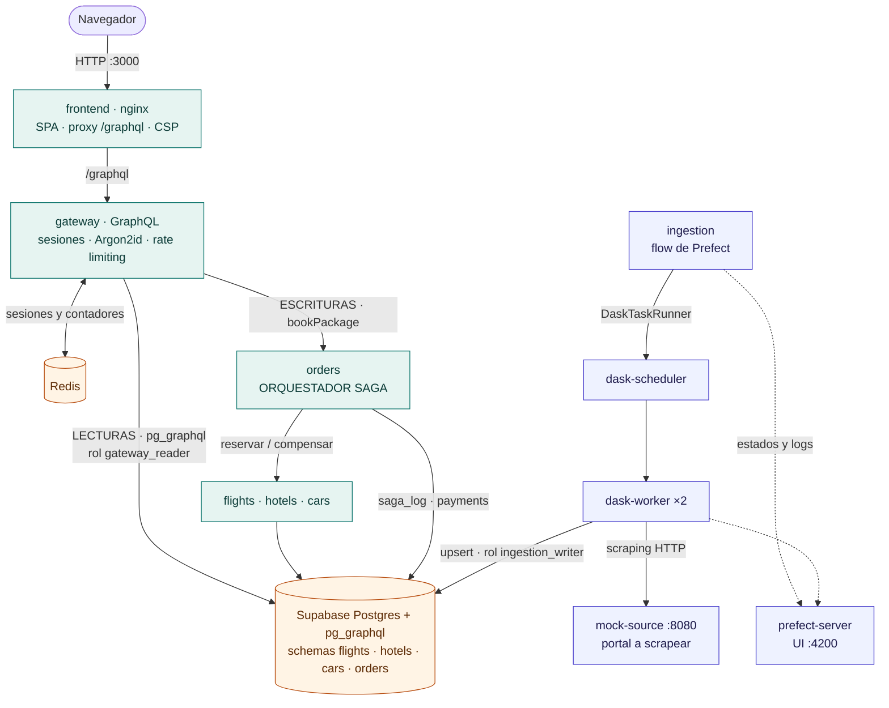

*Verde: ruta transaccional (frontend → gateway → SAGA). Naranja: datos. Azul: ingesta distribuida y
observabilidad. Solo el frontend, Prefect, el dashboard de Dask y la fuente mock publican puertos.*

**Principios aplicados:**

- **Un único punto de entrada** al backend: el frontend solo habla con `/graphql`, que nginx envía al gateway.
- **Separación de lecturas y escrituras (estilo CQRS):** las lecturas del catálogo van a `pg_graphql`, la fuente
  unificada de datos. Las escrituras transaccionales van al orquestador SAGA.
- **Database-per-service lógico:** cada microservicio es dueño de su *schema* y no consulta el de otro.
- **Desacople de la ingesta:** el scraping corre en el clúster de Dask y nunca bloquea los servicios transaccionales.
- **Mínimo privilegio** en red (puertos), base de datos (roles) y contenedores (sin root).

## 3. Componentes y responsabilidades

| Contenedor | Tecnología | Responsabilidad | Puerto host |
|---|---|---|---|
| `frontend` | nginx-unprivileged | Sirve la SPA, hace de proxy de `/graphql` al gateway y aplica CSP y headers | **3000** |
| `gateway` | FastAPI + Strawberry | API GraphQL unificada, autenticación, sesiones y rate limiting | — |
| `orders` | FastAPI + httpx | Órdenes, facturación (`payments`) y **orquestador SAGA** | — |
| `flights` / `hotels` / `cars` | FastAPI | Inventario: reservar (transacción local) y cancelar (compensación) | — |
| `db` | Supabase Postgres 15 | Persistencia; `pg_graphql` expone el catálogo como GraphQL | — |
| `redis` | Redis 7 (con contraseña) | Sesiones del lado del servidor y contadores de rate limiting | — |
| `mock-source` | FastAPI | Portal de viajes simulado: HTML paginado, latencia, fallos 503/429, datos sucios | 8080 |
| `prefect-server` | Prefect 3 | API y UI de orquestación y observabilidad | **4200** |
| `dask-scheduler` | Dask distributed | Coordina las tareas del clúster; expone el dashboard | **8788** |
| `dask-worker` ×2 | Dask distributed | Ejecutan scraping, limpieza, upsert y agregaciones | — |
| `ingestion` | Prefect | *Runner* del flow `ingesta-turistica` (deployment cada 10 min) | — |

### API de los microservicios de inventario (`flights`, `hotels`, `cars`)

| Método | Ruta | Rol en la SAGA |
|---|---|---|
| `GET` | `/offers`, `/offers/{id}` | Consulta del catálogo |
| `POST` | `/bookings` | **Transacción local**: descuenta un cupo (`UPDATE ... WHERE cupos > 0`) y crea la reserva `CONFIRMED`. Es idempotente por `order_id` |
| `POST` | `/bookings/{id}/cancel` | **Transacción de compensación**: marca la reserva `CANCELLED` y devuelve el cupo. Es idempotente |

## 4. Modelo de datos

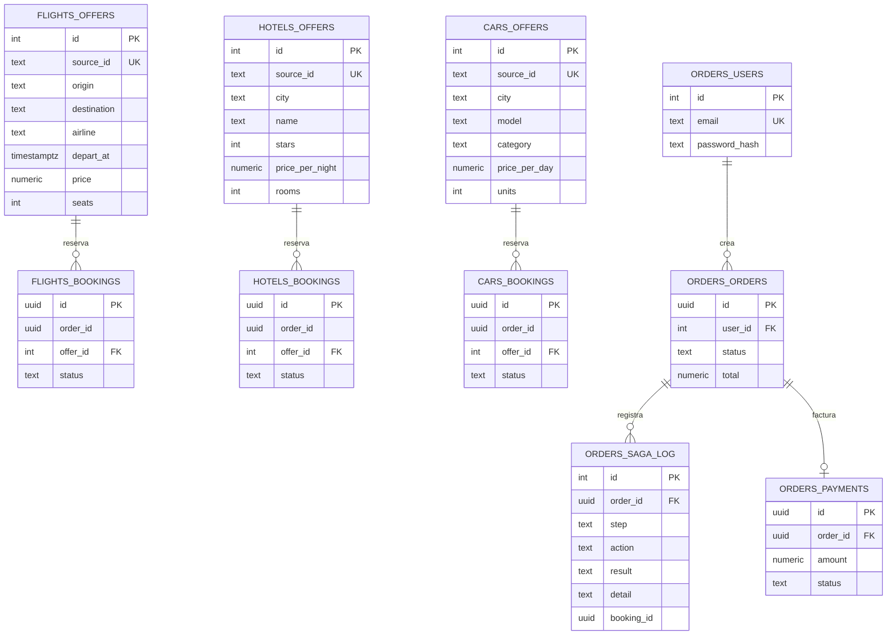

- `source_id` (único) permite que la ingesta haga **upsert**: si la fuente cambia un precio, se actualiza la fila
  en lugar de duplicarla.
- `saga_log` es la **bitácora persistente** de la SAGA. Se usa para auditoría, para la demo y para recuperar
  órdenes huérfanas.

**Roles de base de datos (mínimo privilegio):**

| Rol | Lo usa | Permisos |
|---|---|---|
| `gateway_reader` | gateway (lecturas `pg_graphql`) | Solo `SELECT` sobre las 3 tablas de ofertas. `pg_graphql` ni siquiera genera mutaciones |
| `ingestion_writer` | workers de Dask | `SELECT/INSERT/UPDATE` solo sobre las tablas de ofertas |
| `auth_service` | gateway (usuarios) | `SELECT/INSERT/UPDATE` solo sobre `orders.users` |
| `postgres` | microservicios transaccionales | Acceso a su schema (en Supabase **no** es superusuario) |

## 5. Patrón SAGA

### 5.1 Diseño

Se eligió **SAGA por orquestación**. El servicio `orders` conoce el flujo completo y coordina las transacciones
locales:

| # | Paso | Transacción local | Compensación |
|---|---|---|---|
| 1 | `FLIGHT` | `POST flights/bookings` (descuenta asiento) | `POST flights/bookings/{id}/cancel` |
| 2 | `HOTEL` | `POST hotels/bookings` (descuenta habitación) | `POST hotels/bookings/{id}/cancel` |
| 3 | `CAR` | `POST cars/bookings` (descuenta vehículo) | `POST cars/bookings/{id}/cancel` |
| 4 | `PAYMENT` | Registro del cobro en `orders.payments` | — (es la **transacción pivote**) |

El pago va de último a propósito. Si falla, se compensan las tres reservas. Si tiene éxito, la SAGA ya no
necesita deshacer nada y la orden queda `CONFIRMED`.

**Estados de la orden:** `PENDING` → `CONFIRMED` | `COMPENSATED` | `COMPENSATION_PENDING` (si una compensación
falló después de todos sus reintentos; la recuperación automática la reintenta).

### 5.2 Diagrama de secuencia — camino exitoso (happy path)

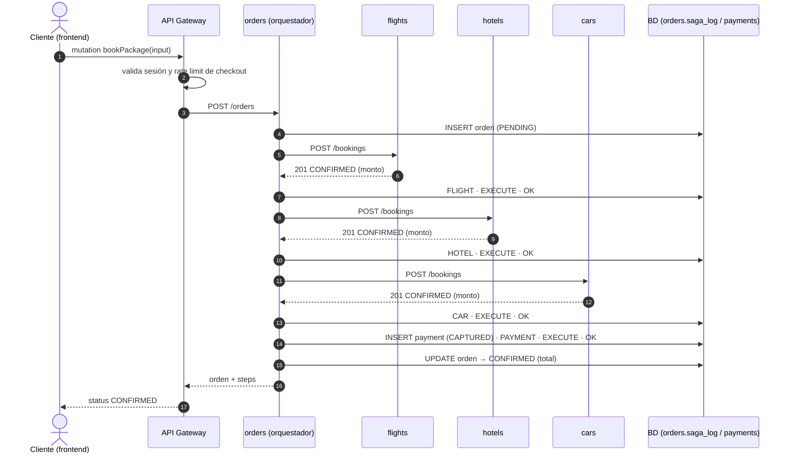

### 5.3 Diagrama de secuencia — falla el auto y se compensa

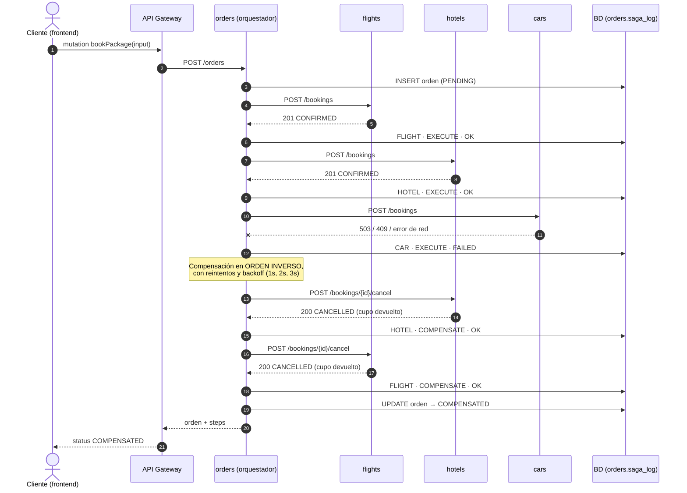

### 5.4 Garantías de consistencia

| Mecanismo | Implementación | Qué evita |
|---|---|---|
| **Compensación en orden inverso** | `compensate()` recorre `reversed(completed)` | Estados intermedios inconsistentes |
| **Idempotencia** | `POST /bookings` devuelve la reserva existente para el mismo `order_id`; `cancel` sobre una reserva ya cancelada no hace nada | Dobles reservas o dobles devoluciones al reintentar |
| **Reintentos con backoff en compensaciones** | 3 intentos (1s, 2s, 3s); si se agotan, la orden queda `COMPENSATION_PENDING` | Compensaciones perdidas por fallos transitorios |
| **Bitácora persistente** | `saga_log` en *autocommit* (cada paso se guarda al instante) | Perder el rastro de qué se ejecutó |
| **Recuperación de huérfanas** | Al arrancar `orders` (y en `POST /orders/recover`) se compensan las órdenes `PENDING` o `COMPENSATION_PENDING` usando el `saga_log` | **Reservas huérfanas** si el orquestador se cae a mitad de una SAGA |
| **Descuento atómico de cupos** | `UPDATE ... SET cupos = cupos - 1 WHERE id = ? AND cupos > 0 RETURNING` | Sobreventa en concurrencia |

**Escenarios demostrables:** `simulateFailureAt` = `FLIGHT` | `HOTEL` | `CAR` | `PAYMENT`, una caída real de un
servicio (`docker compose stop cars`) o falta de cupos (HTTP 409). En todos los casos el inventario queda igual
que antes de la orden fallida.

## 6. API Gateway GraphQL

El esquema completo está en [`schema.graphql`](schema.graphql).

| Operación | Tipo | Descripción |
|---|---|---|
| `flights`, `hotels`, `cars` | Query | Catálogo con filtros, servido desde `pg_graphql` |
| `searchPackages` | Query | **Consulta compleja**: consolida vuelo + hotel + auto, calcula el total, filtra por presupuesto y ordena por precio |
| `myOrders`, `order` | Query | Órdenes del usuario autenticado, con su bitácora SAGA (`steps`) |
| `me`, `session` | Query | Estado de autenticación y huella de la sesión |
| `register`, `login`, `logout` | Mutation | Gestión de identidad |
| `bookPackage` | Mutation | Reserva un paquete ejecutando la SAGA |

### 6.1 Cero over-fetching de extremo a extremo

GraphQL ya evita mandarle al cliente datos que no pidió. Además, el gateway **traduce la selección del cliente a
la consulta que le hace a la base de datos**: lee los campos pedidos (`info.selected_fields`) y arma la consulta
de `pg_graphql` solo con esas columnas.

```graphql
# Lo que pide el cliente
{ flights(destination: "Cartagena") { airline price } }
```

```text
# Lo que el gateway envía a la base de datos (visible con: docker compose logs -f gateway)
query($f_destination: String, $f_seats: Int) {
  flightOfferCollection(filter: {destination: {eq: $f_destination}, seats: {gt: $f_seats}}, ...) {
    edges { node { airline id price } }
  }
}
```

- `searchPackages` resuelve vuelos, hoteles y autos en **una sola llamada** a `graphql.resolve()`.
- `Order.steps` se resuelve de forma **perezosa**: solo se consulta si el cliente lo pide.

### 6.2 Integración con Supabase (`pg_graphql`)

- `pg_graphql` genera el GraphQL directamente desde las tablas: `flightOfferCollection`, `hotelOfferCollection`
  y `carOfferCollection`.
- Las tablas se renombran con `COMMENT ON TABLE ... @graphql({"name": ...})` para evitar el choque de nombres
  (las tres se llaman `offers`), y `inflect_names` convierte a camelCase.
- El gateway ejecuta las lecturas con `SET LOCAL ROLE gateway_reader`. Con ese rol, el esquema de `pg_graphql`
  tiene `mutationType: null`: **es imposible escribir** por esa vía.

### 6.3 Protecciones del endpoint

- `QueryDepthLimiter(max_depth=6)` contra consultas anidadas abusivas.
- `MaskErrors`: los errores internos se devuelven como `Unexpected error.` y nunca filtran trazas al cliente.
- Variables GraphQL en el frontend: nunca se concatenan datos del usuario en el texto de la consulta.

## 7. Ingesta distribuida: Dask + Prefect

### 7.1 Fuente de datos

Cada grupo podía elegir libremente la fuente. Se construyó `mock-source`, un portal simulado que reproduce los
problemas reales de scrapear un sitio público:

| Característica de la fuente | Cómo la maneja el pipeline |
|---|---|
| Solo HTML, paginado (3 páginas × 8 resultados) | BeautifulSoup con selectores CSS |
| Latencia variable (hasta 1 s) | Paralelismo en Dask |
| 20% de fallos: **503** y **429** con `Retry-After` | **Reintentos de Prefect** con backoff exponencial y *jitter* |
| Precios en formatos distintos (`$ 420.000 COP`, `COP 420,000`, `420000 pesos`) | Normalización (`parse_price`) |
| Textos en lugar de números (`Último asiento!`, `Agotado`) | Normalización (`parse_count`) |
| Registros incompletos (sin precio) | Validación y descarte, con conteo en los logs |
| Precios que cambian cada 10 minutos | Deployment programado y upsert por `source_id` |

### 7.2 Flow `ingesta-turistica`

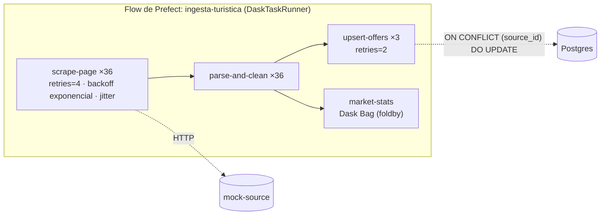

- **36 páginas por ejecución**: 6 rutas de vuelo y 3 ciudades de hoteles y de autos, con 3 páginas cada una.
- Todas las tareas se ejecutan en los **workers de Dask** mediante `DaskTaskRunner(address="tcp://dask-scheduler:8786")`.
- `market-stats` usa **Dask Bag** (`foldby`) para calcular en paralelo el precio promedio por destino y tipo.
- **Resiliencia:** una página que agota sus reintentos se omite sin tumbar la ingesta, y queda contada en
  `paginas_fallidas`. El flow solo falla si no se pudo descargar ninguna página.
- **Programación:** `flow.serve(interval=600)` crea el deployment `ingesta-cada-10-min`, que también se puede lanzar
  desde la UI (*Quick run*). Al arrancar se hace además una ingesta inicial.

### 7.3 Observabilidad

| Herramienta | Qué se ve |
|---|---|
| **Prefect UI** (`:4200`) | Flow runs, grafo de tareas, estados `Retrying` / `AwaitingRetry`, número de intentos, logs (`Fuente respondió 503...`) y el resumen de la ingesta |
| **Dask dashboard** (`:8788`) | *Task stream* por worker, progreso, uso de memoria y CPU |

Medición real de una ejecución: 36 páginas, **0 fallidas tras reintentos**, 7 tareas que necesitaron entre 2 y 4
intentos, y alrededor de 275 ofertas guardadas en unos 20 segundos.

## 8. Ciberseguridad por diseño

### 8.1 Gestión segura de identidad y sesiones

| Requisito | Implementación | Evidencia |
|---|---|---|
| Hashing robusto | **Argon2id** (`argon2-cffi`): `time_cost=3`, `memory_cost=64 MiB`, `parallelism=4`, sal de 16 bytes. Se ejecuta en un hilo aparte para no bloquear el servidor. Rehash automático si se sube el costo | Columna `orders.users.password_hash` con prefijo `$argon2id$v=19$m=65536,t=3,p=4$` |
| **Mitigación de Session Fixation** | Sesiones del lado del servidor en Redis. En el login se **destruye el ID anterior y se emite uno nuevo** (`secrets.token_urlsafe(32)`, 256 bits). Un ID que el servidor no emitió **se rechaza** y se reemplaza | El frontend muestra la *huella* de la sesión antes y después del login (por ejemplo `0200f90677 → 3caa4e07d7`). El ID anterior queda inválido |
| Cookie segura | `HttpOnly` (no accesible desde JS), `SameSite=Strict` (mitiga CSRF), `Secure` configurable para HTTPS, expiración por inactividad de 30 min | Header `Set-Cookie` |
| Anti enumeración de usuarios | Mensaje genérico "Credenciales inválidas" y verificación contra un hash señuelo cuando el usuario no existe (tiempo de respuesta constante) | — |
| Política de contraseñas | Mínimo 10 caracteres, letras y números, máximo 128 | — |
| Control de acceso | `bookPackage`, `myOrders` y `order` exigen sesión; un usuario solo ve sus propias órdenes | — |

### 8.2 Protección de superficie y endpoints (rate limiting)

Contadores de ventana fija en Redis (`INCR` + `EXPIRE`):

| Ruta sensible | Límite |
|---|---|
| `login` | 5 por minuto por IP **y** 10 cada 15 min por cuenta (anti fuerza bruta) |
| `register` | 5 cada 10 min por IP |
| `bookPackage` (checkout y pago) | 5 por minuto por usuario **y** 10 por minuto por IP |
| Todo `POST /graphql` | 120 por minuto por IP → **HTTP 429** con `Retry-After` (anti DoS) |

La IP real la fija nginx con `proxy_set_header X-Real-IP $remote_addr`, que **sobrescribe** cualquier valor que
envíe el cliente. Como el gateway no está publicado, ese header no se puede falsificar.

**Superficie mínima:** solo se publican el frontend, la UI de Prefect, el dashboard de Dask y la fuente mock.
La base de datos, Redis (protegido con contraseña), el gateway y los microservicios solo existen dentro de la red de
Docker. Además hay CSP estricta (`default-src 'self'`), `X-Frame-Options: DENY`, `nosniff`, `Referrer-Policy`, y
GraphiQL y la simulación de fallos se pueden desactivar por variable de entorno.

### 8.3 Seguridad en la cadena de suministro

- **`pip-audit 2.10.1`** sobre el árbol completo de dependencias (directas y transitivas) de los 7 servicios:
  **0 vulnerabilidades conocidas**. Ver el [reporte formal](security/REPORTE_AUDITORIA_DEPENDENCIAS.md) y los
  JSON crudos en `docs/security/pip-audit/`.
- **Control positivo:** auditar `requests==2.25.0` detecta 13 CVE, lo que demuestra que la herramienta funciona.
- Versiones fijadas con `==`, imágenes base oficiales con etiqueta fija y contenedores sin root. Esto limita el
  impacto de una RCE en una librería vulnerable.
- Se reproduce con `.\scripts\audit.ps1` o `./scripts/audit.sh` (se ejecuta en un contenedor limpio).

## 9. Despliegue

Un solo comando: `docker compose up -d --build` levanta **14 contenedores**.

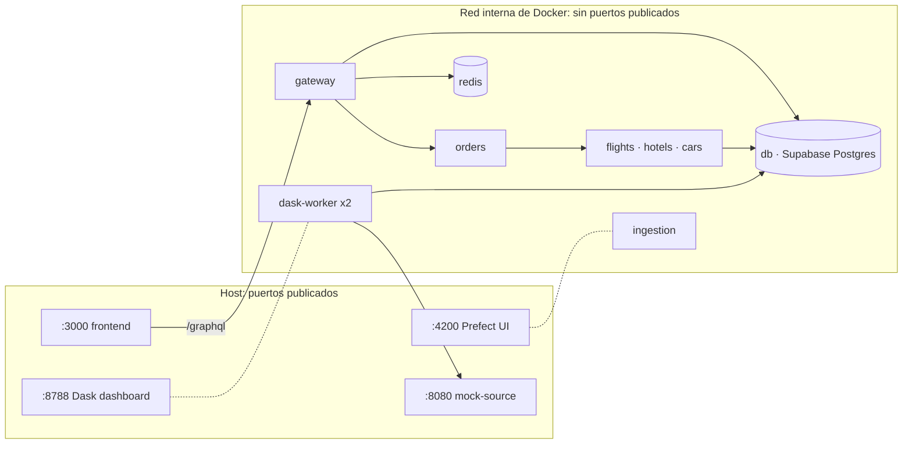

- El orden de arranque se controla con `depends_on` y `healthcheck` (`db`, `redis` y `prefect-server`).
- Configuración por variables de entorno. Los secretos van en `.env` (no versionado; ver `.env.example`).
- `db/init.sql` crea schemas, tablas, roles, la configuración de `pg_graphql` y datos semilla.
- Una sola imagen (`wandersync-ingestion`) se reutiliza para el scheduler, los workers y el runner, garantizando
  el **mismo entorno de software** en todo el clúster de Dask (requisito de Dask para deserializar tareas).

## 10. Decisiones de arquitectura y justificación

| # | Decisión | Alternativas consideradas | Justificación |
|---|---|---|---|
| D1 | **Python + FastAPI** en todos los servicios | Node.js / Java | Dask y Prefect son nativos de Python. Un solo lenguaje simplifica imágenes, auditoría y mantenimiento. FastAPI aporta validación con Pydantic y rendimiento asíncrono |
| D2 | **SAGA por orquestación** | Coreografía con eventos | El flujo es lineal y de 4 pasos. Un orquestador hace explícito el orden y las compensaciones, centraliza la bitácora y facilita depurar y demostrar. La coreografía exigiría un broker y reparte la lógica |
| D3 | **Pago como transacción pivote al final** | Pagar primero | Reservar inventario es reversible sin costo. Cobrar y reembolsar no lo es tanto. Si el pago falla se liberan cupos, y si pasa ya no hay nada que deshacer |
| D4 | **Supabase Postgres + `pg_graphql`** como fuente unificada | Hasura, PostGraphile, Postgres + ORM | El enunciado sugiere Supabase/`pg_graphql`. Es GraphQL nativo dentro de la base, sin otro servicio, y respeta los roles de Postgres (seguridad declarativa) |
| D5 | **Lecturas por `pg_graphql`, escrituras por SAGA** (estilo CQRS) | Que el gateway llame a la API REST de cada servicio para leer | Las lecturas del catálogo no necesitan lógica de negocio y se resuelven en una sola consulta. Las escrituras sí necesitan la consistencia que da la SAGA |
| D6 | **Gateway con Strawberry** sobre `pg_graphql` (y no exponer `pg_graphql` directo) | Exponer `pg_graphql` al frontend | El gateway agrega lo que la base no puede: la consulta compuesta `searchPackages`, autenticación, rate limiting y la orquestación de mutaciones |
| D7 | **Un schema por servicio** en una instancia | Una instancia de Postgres por servicio | Mantiene la propiedad de los datos por servicio con un costo de recursos razonable para el entorno académico. Migrar a instancias separadas no cambia el código |
| D8 | **Dask + Prefect (`DaskTaskRunner`)** | Celery, multiprocessing | Requisito del enunciado. Prefect aporta reintentos declarativos, programación y UI. Dask aporta ejecución distribuida y colecciones (Bag) para agregaciones |
| D9 | **Fuente mock propia** | Scrapear Booking o Kayak | Los portales reales prohíben el scraping en sus términos y bloquean bots. La fuente mock reproduce sus dificultades (HTML, paginación, 503/429, datos sucios) de forma ética y determinista para la demo |
| D10 | **Sesiones en Redis** (servidor) | JWT en el cliente | Permiten **invalidar y regenerar** el ID (requisito de Session Fixation) y cerrar sesión de verdad. Redis también sirve para el rate limiting |
| D11 | **nginx como proxy del frontend** | CORS entre orígenes | Un único origen: la cookie `SameSite=Strict` funciona, no hace falta CORS, y nginx fija la IP real para el rate limiting |

## 11. Evidencias de funcionamiento

**Frontend: búsqueda de paquetes consolidados** (consulta `searchPackages` del gateway). La huella de sesión
aparece arriba a la derecha.

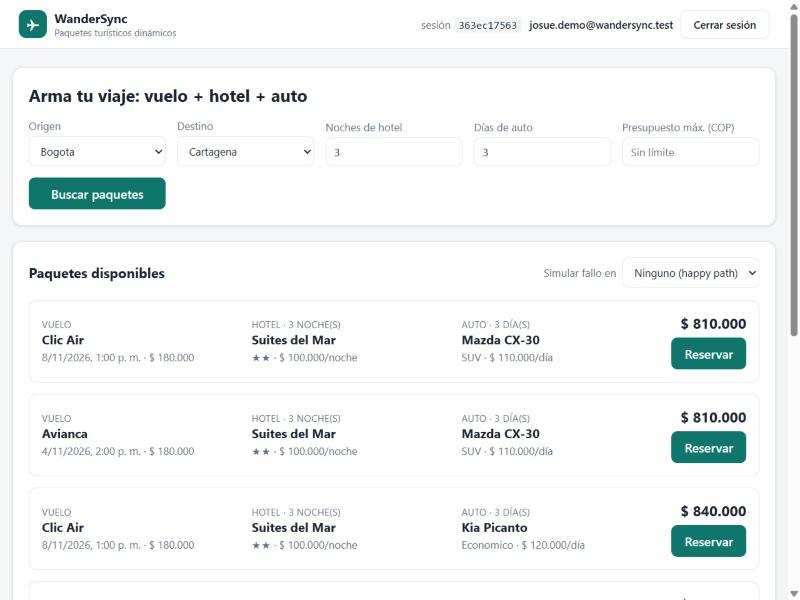

**SAGA, camino exitoso:** los 4 pasos ejecutados y la orden `CONFIRMED`.

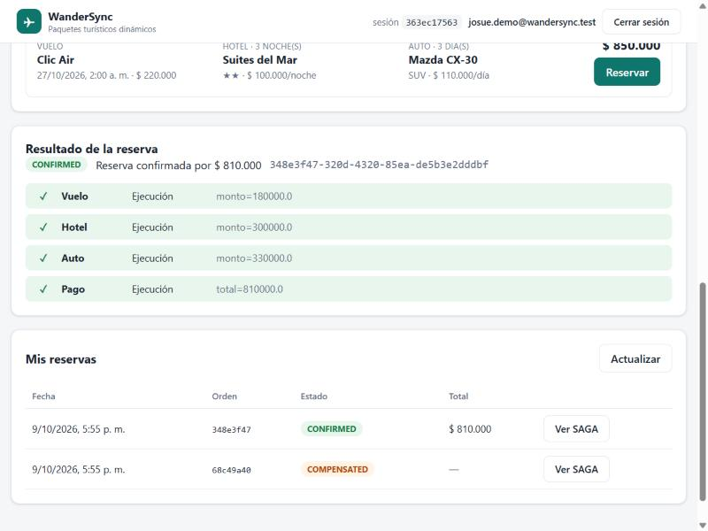

**SAGA con fallo simulado en el auto:** compensación automática del hotel y del vuelo en orden inverso, y la orden
queda `COMPENSATED`.

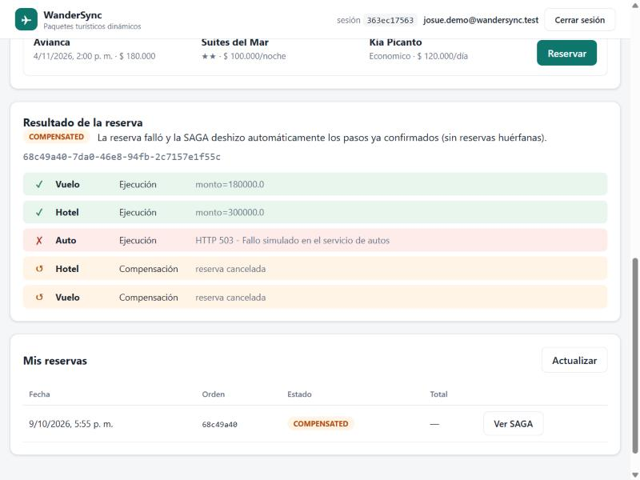

**Prefect: ejecución del flow `ingesta-turistica`** desde el deployment `ingesta-cada-10-min`. Se completaron 76 tareas.

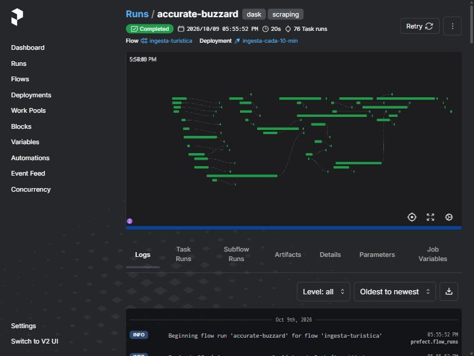

**Prefect: reintentos automáticos.** La fuente respondió 503 y Prefect programó el reintento 1/4 con backoff.

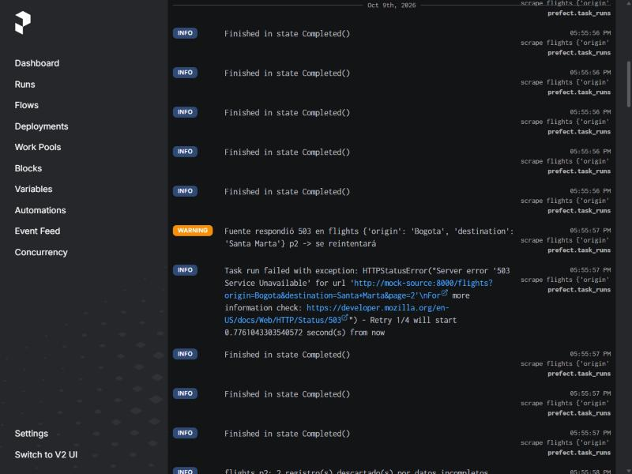

**Dask: *task stream*.** Las tareas se reparten entre los 2 workers (4 hilos) del clúster.

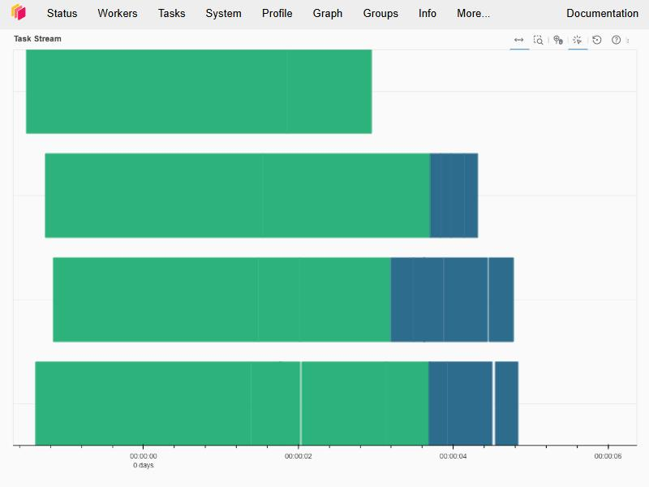

## 12. Trazabilidad con la rúbrica

| Criterio (peso) | Nivel Excelente exigido | Cómo se cumple |
|---|---|---|
| Arquitectura y Dockerización (15%) | Despliegue con `docker compose up`, microservicios aislados | 14 contenedores con un comando, healthchecks, red interna sin puertos expuestos, Dockerfile por servicio, imágenes sin root |
| API Gateway GraphQL y Persistencia (15%) | Gateway funcional, sin over-fetching, integración con BD | Gateway Strawberry, `pg_graphql` de Supabase, selección de campos propagada a la BD, consulta compuesta en una sola llamada |
| Patrón SAGA (25%) | Happy path y compensaciones automáticas impecables | Orquestador con 4 pasos, compensación inversa, idempotencia, reintentos, `saga_log`, recuperación de huérfanas y 5 escenarios de fallo demostrables |
| Dask + Prefect (25%) | Workers de Dask integrados con Prefect, retries y dashboard | `DaskTaskRunner`, 2 workers, reintentos con backoff y jitter, deployment programado, UI de Prefect y dashboard de Dask |
| Ciberseguridad y Resiliencia (20%) | Session Fixation, Argon2id/bcrypt, Rate Limiting, audit | Regeneración y rechazo de IDs, Argon2id, rate limiting en login, registro, checkout y global, reporte `pip-audit` con control positivo, mínimo privilegio |
